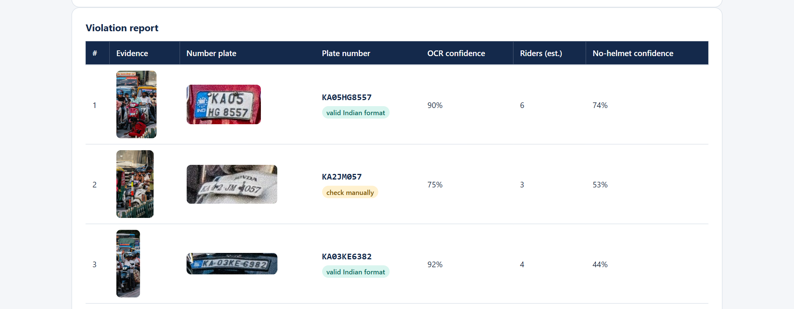
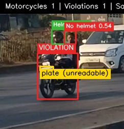
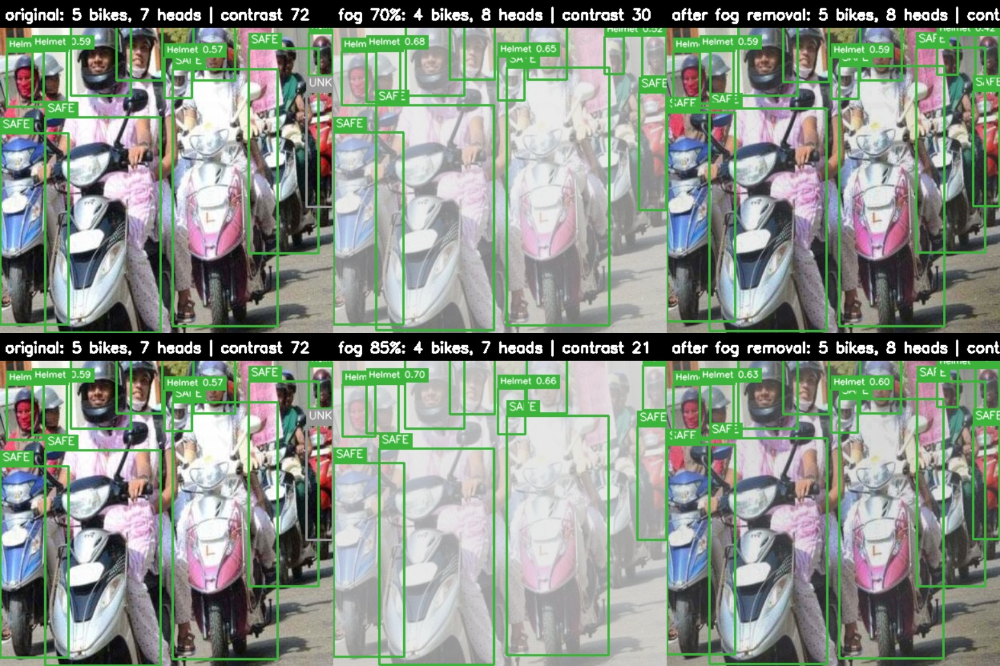
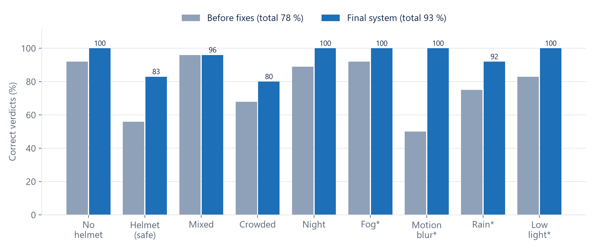
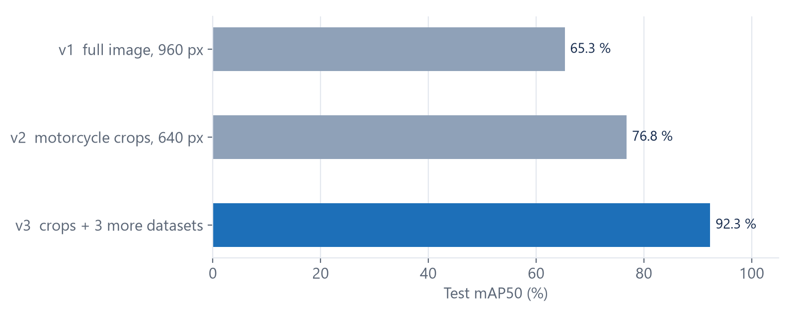
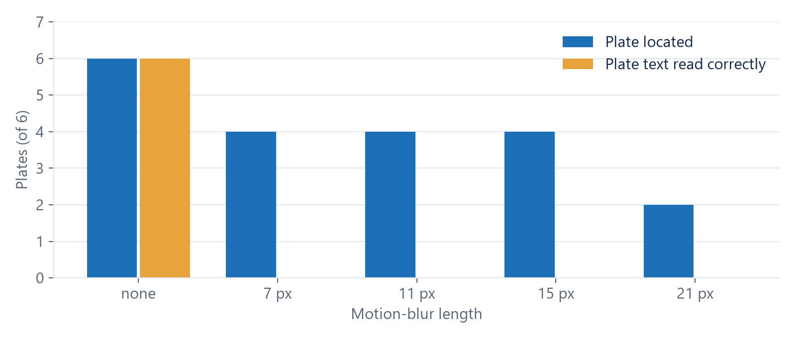
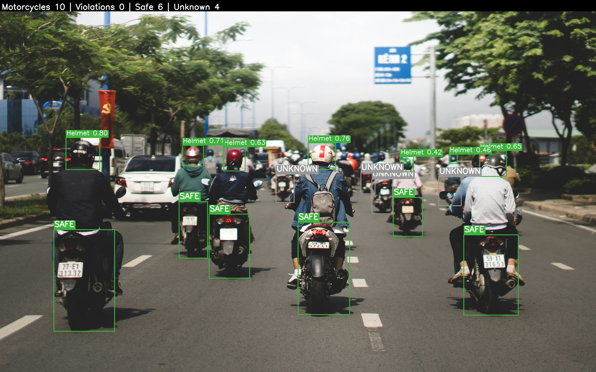
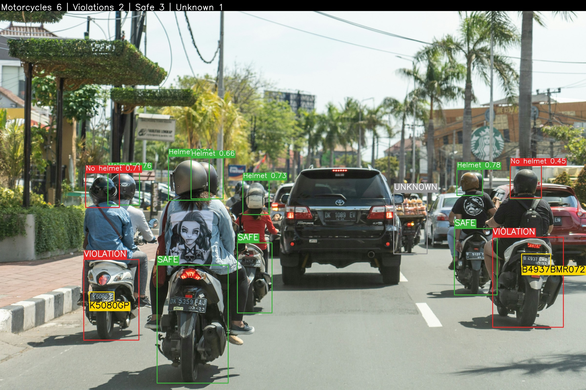

<div class="titlepage">
<p class="uni">GSFC University</p>
<h1>AI-Based Smart Helmet Detection System Using Deep Learning</h1>
<p class="sub">Final Project Report</p>
<p class="team">Purvarajsinh Jadeja (23BT04140, leader) · Ajay Valiya (23BT04167) · Maharsh Patel (23BT04101) · Manan Patel (23BT04103)</p>
<p class="team">Faculty Guide: Prof. Anjali Diwan</p>
<p class="date">October 2026</p>
</div>

## Abstract

Riding a two-wheeler without a helmet is one of the main causes of fatal road injuries in India, yet helmet rules are still enforced mostly by hand, through police checks and people watching camera footage. This project presents an automatic system that analyses traffic images and videos, decides for every motorcycle whether its riders wear helmets, and reads the number plate of every violator. The methodology combines a pretrained detector for motorcycles and people with detectors trained by the team on carefully cleaned public Indian datasets: a head detector that distinguishes riders with and without helmets, and a number-plate detector that works on cropped motorcycles. A geometric association step links heads to their motorcycle; image enhancement is applied only when a quality check finds fog or another degradation; an optical character recognition engine with Indian plate-format repair reads the plate; and video is handled through object tracking and majority voting. The complete pipeline is served by a web application that runs on an ordinary laptop. On held-out test images that the models never saw during training, the trained detectors reach high accuracy, and the complete system gives the correct decision for the large majority of test images, including images with synthetic fog, blur, rain and darkness. Testing also exposed clear limits: helmets seen from behind, caps, very dense crowds, and small or blurred number plates.

---

## 1. Introduction

### 1.1 Background
Two-wheelers are the most common vehicles on Indian roads, and their riders are among the most vulnerable road users. A helmet is the single most effective protection against fatal head injury, and the Motor Vehicles Act (Section 129) requires every person on a two-wheeler, driver and pillion, to wear one. Enforcement, however, depends on traffic police stopping riders or operators watching CCTV footage. Both approaches cover only a small share of traffic, are tiring, miss pillion riders and night traffic, and produce no automatic evidence.

Modern deep-learning object detectors can find people, vehicles and small objects in an image in a fraction of a second, which makes automatic helmet enforcement technically possible.

### 1.2 Problem statement
Given a traffic image or video, automatically determine for every motorcycle whether all its riders wear helmets, and for every violation, provide evidence and the vehicle's registration number. The system must work on Indian traffic (dense scenes, pillion riders, Indian plate formats), tolerate poor image conditions (fog, rain, blur, darkness), avoid false accusations, and run on ordinary hardware.

### 1.3 Objectives
1. Accept images and videos as input.
2. Improve poor-quality images (fog, rain, motion blur, noise, low contrast, low light) when needed.
3. Detect motorcycles, riders and helmet use for every rider.
4. Detect, crop and read the number plate of every violator.
5. Produce a violation report with evidence images, plate number and confidence values.
6. Provide a simple web application to upload files and view and download the results.

### 1.4 Scope
The project covers three phases: (1) building datasets and training the detection models, (2) the complete AI pipeline with a REST API, and (3) a simple web application without login or database. Vehicle-owner notification, a violation history database, and deployment on live traffic cameras are outside the scope and are listed as future work.

---

## 2. Methodology

### 2.1 System architecture
The system is built in three phases (Figure 1). Phase 1 trains two detectors on Kaggle GPUs. Phase 2 combines them with a pretrained detector, image enhancement, OCR and video tracking in a Python pipeline behind a FastAPI service. Phase 3 is a browser page that uploads files to this service and displays the results.

<figure>
<div class="arch">
<div class="lane"><div class="lane-h">Phase 3 · Web application</div><div class="flow"><span>Upload image / video</span><b>→</b><span>Progress</span><b>→</b><span>Results, evidence, plate</span><b>→</b><span>Download</span></div></div>
<div class="down">↓ HTTP (FastAPI REST API)</div>
<div class="lane"><div class="lane-h">Phase 2 · AI pipeline</div>
<div class="flow"><span>Quality check</span><b>→</b><span>Enhancement<br><i>only if needed</i></span><b>→</b><span>COCO detector<br><i>motorcycles, persons</i></span><b>→</b><span>Helmet model<br><i>head boxes</i></span><b>→</b><span>Association<br><i>head → rider → bike</i></span></div>
<div class="flow"><span class="dark">Decision<br><i>SAFE / VIOLATION / UNKNOWN</i></span><b>→</b><span>Motorcycle crop</span><b>→</b><span>Plate model</span><b>→</b><span>OCR + format repair</span><b>→</b><span>Report + evidence</span></div>
<div class="note">Video: frame sampling · ByteTrack tracking · majority vote per motorcycle</div></div>
<div class="down">↑ trained models</div>
<div class="lane"><div class="lane-h">Phase 1 · Training (Kaggle, two GPUs)</div><div class="flow"><span>Public datasets</span><b>→</b><span>Cleaning</span><b>→</b><span>Duplicate removal</span><b>→</b><span>Leak-free split</span><b>→</b><span>Augmentation</span><b>→</b><span>Helmet model · Plate model</span></div></div>
</div>
<figcaption><b>Figure 1.</b> System architecture across the three project phases.</figcaption>
</figure>

**Three detectors with one job each** are used: a COCO-pretrained YOLO26-m finds motorcycles and persons (not retrained); Model A, trained by the team, finds heads of class `helmet` or `no_helmet`; Model B, trained by the team, finds `number_plate` on a crop of the motorcycle. A separate trained "rider" class was deliberately avoided because the source datasets define a rider box differently (per person in some, per vehicle in others).

### 2.2 Data collection and preparation
Eleven public datasets were collected and each was inspected visually (Table 1). Every source had problems: unnamed classes, whole-body boxes labelled as faces, augmented copies, copies of other datasets, or images without labels. The preparation pipeline:

1. **Class mapping** of every source to one schema (`helmet`, `no_helmet`, `number_plate`).
2. **Label cleaning:** boxes are clipped to the image; boxes under 4 px removed; same-class double labels (IoU > 0.9) merged; images removed when a head box covers more than 40 % of the image or one head is labelled both with and without helmet (IoU > 0.6).
3. **Duplicate removal** with perceptual hashing (Section 2.3).
4. **Leak-free split:** similar scenes and frames of one video are grouped and each group is assigned to train, validation or test (80/10/10) by a hash of the group key; test images come only from Indian sources.
5. **Augmentation:** 20 % of training images receive one synthetic weather copy (fog, rain, low light, motion blur or noise); online augmentation during training adds mosaic, scaling, rotation, shear, perspective, colour changes, mixup and horizontal flips (helmet model only, because mirrored plate text is unrealistic).

The final datasets are given in Table 2.

### 2.3 Mathematics

**Intersection over Union (IoU).** For a predicted box *B<sub>p</sub>* and a ground-truth box *B<sub>g</sub>*:
<div class="eq">IoU = |B<sub>p</sub> ∩ B<sub>g</sub>| / |B<sub>p</sub> ∪ B<sub>g</sub>|</div>

**Duplicate detection.** Each image is reduced to a 64-bit perceptual hash (pHash, from the low-frequency DCT coefficients) and a difference hash (dHash). Two images *a*, *b* are near-duplicates when the Hamming distances satisfy
<div class="eq">d<sub>H</sub>(pHash<sub>a</sub>, pHash<sub>b</sub>) ≤ 6 &nbsp; and &nbsp; d<sub>H</sub>(dHash<sub>a</sub>, dHash<sub>b</sub>) ≤ 10 &nbsp; and &nbsp; boxmatch(a, b) ≥ 0.6</div>
where *boxmatch* is the share of label boxes that coincide (IoU ≥ 0.5). The box condition keeps frames from a fixed camera that look identical but show different riders. A looser threshold (pHash ≤ 12) groups similar scenes into the same split.

**Detector training loss.** YOLO26 is trained end-to-end without non-maximum suppression. Its loss combines box regression and classification:
<div class="eq">L = λ<sub>box</sub> · L<sub>box</sub>(IoU, L1) + λ<sub>cls</sub> · L<sub>BCE</sub>, &nbsp; L<sub>BCE</sub> = −[ y log p + (1 − y) log(1 − p) ]</div>

**Learning-rate schedule** (cosine, from *η<sub>0</sub>* = 0.01 to *η<sub>0</sub> · lrf*, lrf = 0.01, over *T* epochs after 3 warm-up epochs):
<div class="eq">η<sub>t</sub> = η<sub>0</sub> · [ lrf + (1 − lrf) · ½ (1 + cos(π t / T)) ]</div>

**Evaluation metrics.** With true positives *TP* (IoU ≥ 0.5 with a correct class), false positives *FP* and false negatives *FN*:
<div class="eq">P = TP / (TP + FP), &nbsp; R = TP / (TP + FN), &nbsp; F1 = 2PR / (P + R)</div>
<div class="eq">AP = ∫<sub>0</sub><sup>1</sup> P(R) dR, &nbsp; mAP50 = (1/C) Σ<sub>c</sub> AP<sub>c</sub> (IoU = 0.5), &nbsp; mAP50-95 = mean of mAP over IoU = 0.50, 0.55, …, 0.95</div>
The deployment confidence threshold of each model is the point of maximum mean F1 on its test-set F1 curve; mAP itself does not depend on this threshold.

**Fog removal (Dark Channel Prior).** The haze model is *I(x) = J(x) t(x) + A (1 − t(x))*, with observed image *I*, haze-free scene *J*, atmospheric light *A* and transmission *t*. The dark channel and the transmission estimate are
<div class="eq">I<sup>dark</sup>(x) = min<sub>y ∈ Ω(x)</sub> min<sub>c ∈ {r,g,b}</sub> I<sup>c</sup>(y), &nbsp; t(x) = 1 − ω · min<sub>Ω</sub> min<sub>c</sub> ( I<sup>c</sup> / A<sup>c</sup> ), &nbsp; ω = 0.9</div>
*t* is refined with a guided filter and the scene is recovered as *J = (I − A) / max(t, 0.15) + A*.

**Other enhancement operations.** Motion blur: unsharp masking *I' = (1 + k) I − k · G<sub>σ=2</sub> * I* with *k = 0.8*. Low light: adaptive gamma *I' = I<sup>γ</sup>*, *γ = clip( ln 0.45 / ln v̄, 0.4, 1 )*, where *v̄* is the mean brightness in [0, 1]. Low contrast: CLAHE on the L channel of the LAB colour space (clip limit 2, 8 × 8 tiles). Noise: non-local means (bilateral filter in fast video mode). Rain: a streak mask followed by Telea inpainting. Image quality is measured by brightness, contrast (standard deviation), haze (mean dark channel), sharpness (variance of the Laplacian) and noise (Immerkær's estimator); each operation runs only when its calibrated threshold is crossed.

**Association and decision.** For a motorcycle box *M* of height *h<sub>M</sub>*, the rider zone is *M* extended upwards by 1.4 *h<sub>M</sub>*. A person *p* is a rider of *M* when area(*p* ∩ zone)/area(*p*) > 0.3 and the person's feet lie within the bike's vertical span. A head is assigned through the rider containing it, otherwise to the nearest motorcycle whose zone contains the head centre. With *H(M)* the set of heads on *M*:
<div class="eq">status(M) = VIOLATION if ∃ h ∈ H(M): h = no_helmet; &nbsp; SAFE if H(M) ≠ ∅ and all h = helmet; &nbsp; UNKNOWN if H(M) = ∅</div>
Heads that belong to no motorcycle (pedestrians) never cause a violation.

**Video voting.** Each tracked motorcycle *k* collects one vote *s<sub>k,f</sub>* ∈ {VIOLATION, SAFE} per analysed frame *f*. It is reported only when it has at least 2 votes, with the majority status:
<div class="eq">status<sub>k</sub> = VIOLATION if #VIOLATION<sub>k</sub> ≥ #SAFE<sub>k</sub>, otherwise SAFE</div>

### 2.4 Training process
Both models start from COCO-pretrained YOLO26-m weights (transfer learning) and are trained on Kaggle with two NVIDIA T4 GPUs in parallel (distributed data parallel) and mixed precision. Table 3 lists the settings. For Model B, every motorcycle in the plate dataset is found with the COCO detector and cropped with 15 % padding; plates whose motorcycle was not found get a context crop (training split only). The same padding is used at run time.

### 2.5 Pipeline, video and web application
For each image, the pipeline runs the quality check and enhancement, the three detectors, association and the decision. Small images run the COCO detector at its native 640 px; overlapping duplicate motorcycle boxes are merged; and when no motorcycle is visible at all but heads are, riders are judged from their heads. For each violation the motorcycle is cropped, Model B finds the plate, and PaddleOCR (PP-OCRv5) reads it. Look-alike characters are repaired using the Indian plate format: each position must be a letter or a digit, the first two letters must be a real state code, and Bharat-series and Delhi formats are supported. Videos are analysed at five frames per second with ByteTrack tracking and majority voting; 4K frames are processed at Full HD, while plates are read from the full-resolution frame. The FastAPI service exposes image, video-job, result and file endpoints, and the web page (Figure 2, Figure 3) shows the verdict, counts, the original and processed image, a violation table with evidence and plate crops, and download buttons.

### 2.6 Pseudocode

```
procedure ANALYSE_IMAGE(I):
    q ← QUALITY(I)
    E ← ENHANCE(I, q)                       # only the operations whose threshold is crossed
    D ← E if "fog" ∈ q.flags else I         # detection uses the original unless foggy
    bikes, persons ← COCO_DETECT(D, size = 640 if max(I.size) ≤ 960 else 960)
    bikes ← MERGE_DUPLICATES(bikes)
    heads ← HELMET_DETECT(D)
    if bikes = ∅ and heads ≠ ∅: motos ← HEAD_ONLY_RIDERS(persons, heads)
    else:                       motos ← ASSOCIATE(bikes, persons, heads)
    for m in motos:
        m.status ← VIOLATION if any head is no_helmet else SAFE if heads else UNKNOWN
        if m.status = VIOLATION:
            crop ← EXPAND(m.box, 15%)
            plate ← PLATE_DETECT(crop)
            text ← OCR(plate);  if not VALID(text): text ← OCR(flip/rotate/enhanced)
            m.plate ← REPAIR_INDIAN_FORMAT(text)
    return REPORT(motos, evidence crops, annotated image)

procedure ANALYSE_VIDEO(V):
    for every k-th frame F (5 per second):
        tracks ← TRACK(ANALYSE_IMAGE(F))
        for t in tracks: votes[t.id] += t.status; read plate on ≤ 4 frames per track
    report each track with ≥ 2 votes using the majority status and its most frequent valid plate
```

---

## 3. Results and Discussion

### 3.1 Detection models
On the held-out test sets, the helmet model reaches a mAP50 of 0.891 and the plate model 0.923 (Table 4). Precision and recall are balanced for both models, which shows that the deployment threshold at maximum F1 does not favour one error type. The moderate mAP50-95 values mean that objects are found reliably but boxes are not always tight; for OCR this is handled by padding the plate crop. Validation accuracy of the helmet model peaked at about epoch 70, after which the validation classification loss rose while training loss kept falling. This is the onset of overfitting, so more and harder data, not longer training, is the next lever.

**Plate model experiments** (Table 5, Figure 7) show where the accuracy came from. Searching the full image gave 0.653, because a plate in a traffic image is often only 20–40 pixels wide. Searching only inside the motorcycle crop enlarged the plate about five times and removed car plates (0.768). Adding three more plate datasets raised it to 0.923. On the one test source identical across experiments, the final model scores 0.838, still clearly above the previous version, so the gain is not only an effect of the larger test set.

### 3.2 Effect of image enhancement
An A/B test on 107 unseen images with synthetic degradations (Table 6) showed that automatic enhancement does **not** improve detection, and it lowers accuracy in low light. The models had already learned these conditions through weather augmentation, so enhancing the input moves it away from what they were trained on. Detection therefore runs on the original image, and the enhanced image is shown to the user and used as a second OCR attempt. The exception is heavy fog: dark-channel dehazing recovered a motorcycle that heavy synthetic fog had hidden (Figure 5), so the de-fogged image is used whenever fog is detected.

### 3.3 Complete system on a held-out demo test set
To evaluate the whole pipeline rather than a single model, a categorised test set of 157 images with ground truth was built only from the test split. Every image was checked against the training run's own split records, and none had been used for training. An image counts as correct when the system's verdict (VIOLATION or SAFE) matches the ground truth.

Manual testing of the first version revealed two pipeline faults that the model-level metrics could not show. First, small web images were upscaled before the COCO detector, which made it miss motorcycles or split one scooter into several weak boxes, so 27 images received no result at all. Second, close-up photos without a visible motorcycle discarded correctly detected heads. After running the COCO detector at its native size on small images, merging duplicate motorcycle boxes, and adding a head-only fallback, overall accuracy rose from 78 % to 93 % (146 of 157), and images with no result dropped to zero (Table 7, Figure 6).

The system is fully correct on riders without helmets, on real night images, and on images with synthetic fog, motion blur and low light. Pillion riders without helmets are flagged correctly even when the driver wears one (Figure 4), as the law requires. The weakest categories are images of riders who all wear helmets (83 %), where helmets seen from behind or from the side are sometimes classified as missing (Figure 10), and dense crowds (80 %), where one wrong head among eight to thirteen small heads changes the verdict. One original dataset label was found to be wrong during manual testing (two riders labelled with helmets had none); it was corrected, and the model had been right.

### 3.4 Number-plate reading
With plate reading enabled for every motorcycle, the plate is located in 24 of 25 plate test images, text is read in 16, and a valid Indian number in 11 (Table 8). Clear plates are read correctly; failures are mostly plates only a few pixels high or blurred. A controlled test with added motion blur (Figure 8) shows that the plate is still located under strong blur, but its text cannot be read correctly even with light blur. Plate reading therefore needs sharp, sufficiently large plates, which a real traffic camera with a fast shutter provides. Errors between similar letters (for example W and N, Q and O) remain possible on dirty plates, so every reading is shown with its confidence and the plate crop for human verification (Figure 3).

### 3.5 Video and speed
The video pipeline reports each rider once: in the demo clip, every analysed frame voted VIOLATION, both riders were counted, and nine of ten plate characters were read correctly. Profiling a 4K video revealed that the OCR library silently reduced the deep-learning framework to a single CPU thread after its first call. Restoring the thread count and processing 4K frames at Full HD made video processing 2.4 times faster, and reading plates from the full-resolution frame raised the number of plates read (Table 9). On the team's CPU-only laptop, an image takes a few seconds and a 4K video about thirteen seconds per second of footage; a GPU is used automatically when present.

### 3.6 Comparison with alternatives
YOLO was compared with other detector families on design grounds (Table 10). Two-stage detectors such as Faster R-CNN are several times slower, SSD is weak on small objects such as distant heads and plates, and transformer detectors need more data than was available. Within the project, the crop-based plate design (Table 5) and the native-size vehicle detection (Table 7) are the two design changes with the largest measured effect.

---

## 4. Table Description

<p class="tcap"><b>Table 1.</b> Public datasets used, with the problem found in each.</p>

| Source | Images | Used for | Main issue found and fixed |
|---|---|---|---|
| Indian Helmet (aryanvaid13, Kaggle) | 942 | helmet, plate | classes named 0–4, checked visually; 51 whole-body "face" boxes removed |
| Smart Helmet (Kaggle) | 485 | helmet | copies of another dataset; 67 duplicates removed |
| Rider / helmet / plate (aneesarom, Kaggle) | 124 | helmet, plate | RGBA images converted to RGB |
| EdgeVision (Mendeley, 2026) | 2,392 | helmet | VOC labels converted to YOLO |
| Helmet & NumberPlate (Roboflow) | 6,015 | helmet, plate | 3× augmented copies, about 1,224 unique |
| HelmetDetection (Roboflow) | 1,081 | helmet, plate | duplicates removed |
| HelmetViolations (Kaggle) | 1,937 | plate | rider-level helmet boxes; plates only; about 250 unique |
| Indian plates (deepakat002, Kaggle) | 160 | plate | 3 videos, each kept in one split |
| Traffic Violations (Kaggle) | 11,772 | plate | 6,621 images without plate labels dropped |
| Rider Helmet Plate (Kaggle) | 1,596 | plate | no class names; ids checked visually |
| Gujarat plates (Kaggle) | 355 | plate | – |

*Description:* raw image counts per source and how each was used. *Key observations:* no source was usable as published; augmented copies and cross-dataset copies would have inflated the test scores if not removed, and only datasets that box the head could be used for the helmet model.

<p class="tcap"><b>Table 2.</b> Final datasets after cleaning (unique images).</p>

| Dataset | Train | Validation | Test | Total |
|---|---|---|---|---|
| Helmet | 4,747 (+908 weather copies) | 512 | 334 | 5,593 |
| Plate (full images; motorcycle crops built from these) | 4,193 | 311 | 204 | 4,708 |

*Description:* split sizes after duplicate removal and grouping. *Key observations:* the test sets contain only Indian images and no near-copies of training images, so the reported scores reflect unseen data.

<p class="tcap"><b>Table 3.</b> Training configuration.</p>

| Parameter | Value | Reason |
|---|---|---|
| Starting weights | YOLO26-m, COCO-pretrained | transfer learning; largest size that fits a T4 GPU |
| Image size | 960 px (helmet), 640 px (plate crops) | heads are small; crops are already enlarged |
| Batch | 16 (8 per GPU, two GPUs) | fits GPU memory with mixed precision |
| Optimizer, learning rate | MuSGD (auto), 0.01, cosine schedule, 3 warm-up epochs | defaults tuned for YOLO26 |
| Epochs | up to 200, 10.5 h cap, early stop after 40 epochs without gain | fits the 12 h Kaggle session |
| Seed | 42 | reproducibility |

*Description:* settings shared by both trained models. *Key observations:* hyper-parameter search was implemented but not run, because of the GPU quota; the time cap and early stopping kept every run within one session.

<p class="tcap"><b>Table 4.</b> Test results of the trained detectors.</p>

| Model | mAP50 | mAP50-95 | Precision | Recall | F1 | Deploy threshold |
|---|---|---|---|---|---|---|
| A: Helmet (334 test images) | **0.891** | 0.531 | 0.838 | 0.840 | 0.839 | 0.40 |
| B: Plate (222 crops from 204 images) | **0.923** | 0.482 | 0.910 | 0.890 | 0.900 | 0.37 |

*Description:* standard detection metrics on the held-out test sets. *Key observations:* both models are accurate and balanced between precision and recall; box tightness (mAP50-95) is moderate.

<p class="tcap"><b>Table 5.</b> Plate-model experiments.</p>

| Version | Change | Test mAP50 | Test recall |
|---|---|---|---|
| v1 | full images at 960 px | 0.653 | 0.726 |
| v2 | motorcycle crops at 640 px + context crops | 0.768 | 0.735 |
| v3 (final) | v2 + three more plate datasets | **0.923** | **0.890** |

*Description:* three training runs of the plate detector. *Key observations:* the crop-based design and more data each gave a large gain; missed plates fell from 27 % to 11 %.

<p class="tcap"><b>Table 6.</b> Helmet-model mAP50 with and without automatic enhancement (107 unseen images).</p>

| Condition | No enhancement | Automatic enhancement |
|---|---|---|
| Clean (reference) | 0.845 | – |
| Fog | 0.852 | 0.849 |
| Low light | **0.830** | 0.805 |
| Motion blur | 0.725 | 0.723 |
| Noise | 0.832 | 0.834 |

*Description:* A/B test of enhancement before detection. *Key observations:* enhancement gives no gain and hurts in low light, so detection uses the original image (except heavy fog).

<p class="tcap"><b>Table 7.</b> Complete-system verdict accuracy on the categorised demo test set (157 images).</p>

| Category | Images | Before pipeline fixes | Final system |
|---|---|---|---|
| No helmet | 26 | 92 % | **100 %** |
| Helmet (all safe) | 24 | 56 % | **83 %** |
| Mixed (helmet and no helmet on one bike) | 25 | 96 % | **96 %** |
| Crowded traffic (6+ heads) | 25 | 68 % | **80 %** |
| Real night / dark | 9 | 89 % | **100 %** |
| Synthetic fog | 12 | 92 % | **100 %** |
| Synthetic motion blur | 12 | 50 % | **100 %** |
| Synthetic rain | 12 | 75 % | **92 %** |
| Synthetic low light | 12 | 83 % | **100 %** |
| **Total** | **157** | **78 %** | **93 %** |
| Images with no result | | 27 | **0** |

*Description:* share of images where the system's VIOLATION/SAFE decision matches the ground truth. *Key observations:* the pipeline fixes found by manual testing gave the largest single improvement in the project; remaining errors concentrate on rear-view helmets and dense crowds.

<p class="tcap"><b>Table 8.</b> Number-plate reading on the plate test category (25 images, all plates read).</p>

| Measure | Before fix | Final |
|---|---|---|
| Plate located | 19 | **24** |
| Text read | 11 | **16** |
| Valid Indian registration number | 4 | **11** |

*Description:* plate stages on images that mostly show riders with helmets or parked bikes. *Key observations:* locating plates is reliable; reading them is limited by plate size and sharpness.

<p class="tcap"><b>Table 9.</b> Video processing on the team's laptop (AMD Ryzen 5 5500U, no GPU).</p>

| Video | Length | Processing time | Result |
|---|---|---|---|
| Demo clip (576 × 720) | 4.4 s | 31 s | 1 violation, 2 riders, 9 of 10 plate characters correct |
| Full HD, 25 fps | 7 s | 55 s | 5 motorcycles, all safe |
| 4K, 30 fps | 10.5 s | 2 min 13 s | 13 violations, 6 safe, plates read |
| 4K, 60 fps | 15 s | 3 min 18 s (before fix: 7 min 56 s) | 10 violations, 3 safe, plates read |

*Description:* end-to-end processing time including tracking, plate reading and video encoding. *Key observations:* the thread fix and Full-HD processing made video 2.4 times faster; in the 4K videos some riders were counted twice after a tracking interruption.

<p class="tcap"><b>Table 10.</b> Detector families considered.</p>

| Detector | Type | Speed | Small objects | Decision |
|---|---|---|---|---|
| YOLO26 / YOLO11 | one-stage, anchor-free, NMS-free (YOLO26) | real-time | good at 960 px | **chosen** |
| Faster R-CNN | two-stage | 5–10× slower | good | too slow for video |
| SSD | one-stage, anchors | fast | weak | misses small heads |
| DETR / RT-DETR | transformer | slow / fast | weaker | needs more data |

*Description:* qualitative comparison used to choose the detector. *Key observations:* YOLO offers the best accuracy per unit of time for many small objects per image and exports easily.

---

## 5. Figure Citations

<figure><figcaption><b>Figure 2.</b> Web application result for a Bengaluru street photo: verdict, counts, processing time, and the original next to the processed image (red = no helmet, green = helmet, yellow = plate).</figcaption></figure>
*Description:* the system marks three motorcycles as violations and one as safe in dense mixed traffic. *Relevance:* shows the complete pipeline and the Phase 3 interface on a real photo that is not part of any dataset.

<figure><figcaption><b>Figure 3.</b> Violation report in the web application: evidence crop, plate crop, plate number with format check, OCR confidence, rider estimate and no-helmet confidence.</figcaption></figure>
*Description:* two plates pass the Indian-format check; one is partly read and flagged "check manually". *Relevance:* demonstrates that the system never invents a number and supports human verification.

<figure><figcaption><b>Figure 4.</b> Driver with a helmet and pillion rider without one: the motorcycle is correctly reported as a violation.</figcaption></figure>
*Description:* the green head box is the driver, the red head box the pillion. *Relevance:* confirms the decision rule follows the law, which requires a helmet for every rider.

<figure><figcaption><b>Figure 5.</b> Fog removal: original, heavy synthetic fog, and the dehazed image with detections.</figcaption></figure>
*Description:* heavy fog hides one motorcycle; Dark Channel Prior dehazing recovers it. *Relevance:* justifies running detection on the enhanced image only when fog is detected.

<figure><figcaption><b>Figure 6.</b> Complete-system verdict accuracy per test category before and after the pipeline fixes (* = synthetic condition).</figcaption></figure>
*Description:* grey bars show the first version, blue bars the final system. *Relevance:* visual summary of Table 7 and of the improvement gained through manual testing.

<figure><figcaption><b>Figure 7.</b> Test mAP50 of the three plate-model versions.</figcaption></figure>
*Description:* each design change raised plate accuracy. *Relevance:* supports the motorcycle-crop design and the value of additional data.

<figure><figcaption><b>Figure 8.</b> Plates located and read correctly as motion blur increases (6 clear plates).</figcaption></figure>
*Description:* location survives strong blur; correct reading fails already with light blur. *Relevance:* explains why plate reading needs sharp frames and motivates the camera requirements.

<figure><figcaption><b>Figure 9.</b> Street scene with many riders wearing helmets: all decided riders are safe and no false violation is raised.</figcaption></figure>
*Description:* motorcycles whose heads are hidden are marked unknown instead of guessed. *Relevance:* demonstrates the conservative design that avoids false accusations.

<figure><figcaption><b>Figure 10.</b> Limitation on a new street photo: two riders wearing helmets, seen from behind, are classified as "no helmet" (left and right), while the riders in the centre are correctly safe.</figcaption></figure>
*Description:* the riders wear helmets, but the model has seen few rear views of helmets. *Relevance:* illustrates the main remaining error source and the motivation for rear-view retraining.

---

## 6. Conclusion

The project delivers a complete, tested system that takes a traffic image or video and returns, for every motorcycle, a safe, violation or unknown decision with evidence and the violator's number plate, through a simple web application that runs offline on an ordinary laptop. Two detectors trained on cleaned, leak-free Indian data achieve high accuracy on unseen test images (helmet mAP50 0.891, plate mAP50 0.923), and the complete pipeline gives the correct verdict on 93 % of a held-out categorised test set, including all synthetic fog, motion-blur and low-light images. The largest gains came from data quality and design decisions, namely duplicate removal, honest test splits, crop-based plate detection and native-size vehicle detection, each verified by measurement; measurement also showed that image enhancement does not help the trained detectors except in heavy fog.

---

## 7. Conclusions and Limitations

### 7.1 Conclusions
1. **Automatic helmet enforcement is feasible on ordinary hardware.** The system detects riders without helmets, including pillion riders, and reads plates without manual work, on a CPU-only laptop.
2. **Data quality matters more than model size.** Cleaning, duplicate removal and leak-free splitting gave reliable test scores; adding clean data raised plate accuracy more than any training change.
3. **Task-specific design beats generic design.** Detecting plates on the motorcycle crop and running the vehicle detector at its native resolution produced the largest measured improvements.
4. **End-to-end testing is essential.** Model-level metrics were high, yet manual testing of the complete pipeline found faults that cost fifteen percentage points of system accuracy; fixing them raised it from 78 % to 93 %.
5. **Enhancement must be measured, not assumed.** For detectors trained with weather augmentation, enhancement helps only in heavy fog.
6. **The design is conservative.** The system marks unknown instead of guessing, never counts pedestrians, flags uncertain plates for manual checking, and keeps evidence for every decision.

### 7.2 Limitations
1. **Rear and side views of helmets.** Helmets seen from behind or from the side are sometimes classified as missing, because such views are rare in the training data. This is the main error source among riders who all wear helmets (83 % correct).
2. **Caps and head coverings.** Caps and similar coverings can be mistaken for helmets, especially in small, low-resolution images.
3. **Dense crowds.** With many small, overlapping heads, a single wrong head changes the image verdict (80 % correct).
4. **Hidden motorcycles.** A motorcycle mostly hidden by another vehicle, plants or the image edge may not be detected, and its riders are then linked to a neighbouring bike: helmet status stays correct but the motorcycle and violation counts are too low.
5. **Plate reading.** Text is unreadable on plates only a few pixels high and under motion blur, even when the plate is located; similar characters (W/N, Q/O) can be confused on dirty or damaged plates; a correct reading is never guaranteed without human verification.
6. **Video tracking.** When a rider is hidden for a moment, the tracker may assign a new identity, so one rider can be reported twice.
7. **Speed without a GPU.** On the CPU-only laptop, 4K video takes about thirteen seconds per second of footage, which is far from real time.
8. **Synthetic weather tests.** Fog, rain, blur and low-light robustness was measured on synthetically degraded images; no labelled real rainy or foggy CCTV footage was available.
9. **Rain detection.** Automatic rain detection could not separate rainy from clear images, so rain removal is a manual option.
10. **Test-set size and source.** Some categories and per-source test subsets are small (nine to twenty-six images), and all images come from public datasets and stock photos, not from a deployed traffic camera.
11. **No hyper-parameter search.** Default, framework-tuned hyper-parameters were used because of the limited GPU quota.
12. **Driver-only rules are not supported.** The system applies the legal rule that every rider must wear a helmet; identifying the driver specifically would require additional modelling.

### 7.3 Future work
Retraining with rear-view heads (the automatic pseudo-labelling code is already implemented), adding caps and other coverings as hard negatives, owner notification through a vehicle registry with human confirmation, a violation history and dashboard, a learned rain detector, plate super-resolution with human verification, and deployment on GPU servers or edge devices connected to real traffic cameras.

---

## References
1. J. Redmon, S. Divvala, R. Girshick, A. Farhadi, "You Only Look Once: Unified, Real-Time Object Detection," CVPR, 2016.
2. Ultralytics, "YOLO26 and Ultralytics YOLO documentation," docs.ultralytics.com.
3. K. He, J. Sun, X. Tang, "Single Image Haze Removal Using Dark Channel Prior," CVPR, 2009.
4. K. He, J. Sun, X. Tang, "Guided Image Filtering," ECCV, 2010.
5. K. Zuiderveld, "Contrast Limited Adaptive Histogram Equalization," Graphics Gems IV, 1994.
6. A. Buades, B. Coll, J.-M. Morel, "A Non-Local Algorithm for Image Denoising," CVPR, 2005.
7. J. Immerkær, "Fast Noise Variance Estimation," Computer Vision and Image Understanding, 1996.
8. A. Telea, "An Image Inpainting Technique Based on the Fast Marching Method," Journal of Graphics Tools, 2004.
9. Y. Zhang et al., "ByteTrack: Multi-Object Tracking by Associating Every Detection Box," ECCV, 2022.
10. Y. Du et al., "PP-OCR: A Practical Ultra Lightweight OCR System," arXiv:2009.09941, 2020; PaddleOCR (PP-OCRv5), github.com/PaddlePaddle/PaddleOCR.
11. S. Ren, K. He, R. Girshick, J. Sun, "Faster R-CNN," NeurIPS, 2015; W. Liu et al., "SSD: Single Shot MultiBox Detector," ECCV, 2016; N. Carion et al., "End-to-End Object Detection with Transformers (DETR)," ECCV, 2020.
12. Government of India, The Motor Vehicles Act, 1988, Section 129 (wearing of protective headgear).
