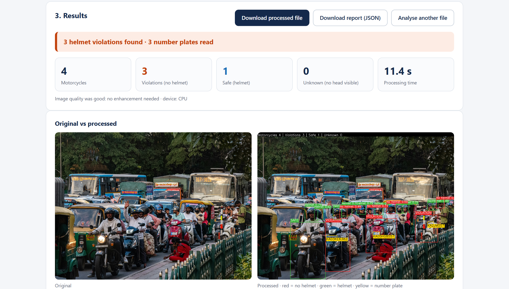
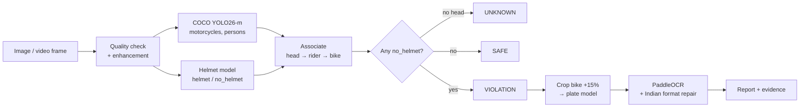

<div align="center">

# Smart Helmet Detection

**AI-based helmet-violation detection and number-plate reading for Indian traffic images and videos**


</div>

Upload a traffic photo or video and the system marks every motorcycle as **SAFE**, **VIOLATION** or **UNKNOWN**. For every violation it reads the **number plate**, saves evidence images and writes a JSON violation report. It runs offline on a laptop (CPU or GPU).



## Highlights

- **Two custom YOLO26-m detectors**, fine-tuned from COCO on 11 cleaned public datasets: a head-level **helmet / no_helmet** model and a **number-plate** model.
- **Plate detection on motorcycle crops** instead of the full image: test mAP50 rose from **65.3% to 92.3%**.
- **Rule-based association** of heads → riders → motorcycles, so pedestrians never cause violations and pillion riders are checked too.
- **Image enhancement only where needed** (fog, blur, noise, low contrast, low light, rain), driven by a measured quality check.
- **Indian plate OCR** with PaddleOCR plus format repair (`MH I2 AB I234` → `MH12AB1234`, Bharat-series and Delhi formats).
- **Video support** with ByteTrack tracking and majority voting: each rider is reported once.
- **FastAPI backend + web page**: drag and drop, side-by-side result, evidence table, downloads.

## Results

All test images are Indian, held out completely, and never used for training or for picking the best epoch.

| Model | Test set | mAP50 | Precision | Recall | F1 | mAP50-95 |
|---|---|---|---|---|---|---|
| Helmet (Model A) | 334 images | **0.891** | 0.838 | 0.840 | 0.839 | 0.531 |
| Number plate (Model B) | 222 motorcycle crops | **0.923** | 0.910 | 0.890 | 0.900 | 0.482 |

**Complete system** on 157 unseen, categorised test images (positive class = VIOLATION):

| Actual \ Predicted | VIOLATION | SAFE |
|---|---|---|
| **VIOLATION** (88) | 85 | 3 |
| **SAFE** (69) | 8 | 61 |

Accuracy **93.0%** · Recall **96.6%** · Precision **91.4%** · F1 **0.94**. Most false alarms are helmets seen from behind; the misses are tiny heads in distant CCTV views.

## How it works



| Stage | Method | Why |
|---|---|---|
| Fog / haze | Dark Channel Prior + guided filter | Recovers objects hidden by fog; the only enhancement used for detection |
| Motion blur | Unsharp masking | Restores edges without knowing the blur kernel |
| Noise | Non-local means (bilateral for video) | Removes grain, keeps edges |
| Low contrast / low light | CLAHE (LAB) / adaptive gamma | Local contrast and brightness without colour shifts |
| Rain | Streak mask + Telea inpainting | On request only (automatic rain detection was unreliable) |
| Video | 5 fps sampling, ByteTrack, ≥ 2-frame majority vote | One report per rider, robust to single-frame errors |

An A/B test on 107 unseen degraded images showed that enhancement does **not** raise detection accuracy (the models learned bad weather through augmentation), so detection uses the original image except under fog. The enhanced image is shown to the user and used for a second OCR attempt.

## Quick start (Windows)

Requires Python 3.10–3.12.

```bash
git clone https://github.com/purvrajsinhjadeja31105-dotcom/smart-helmet-detection.git
cd smart-helmet-detection
python -m venv .venv
.venv\Scripts\activate
pip install -r backend\requirements.txt
```

Then double-click **`start_app.bat`**: the models load (about 30 s) and the browser opens **http://localhost:8000**. Drag in an image or video.

The COCO detector and the PaddleOCR models download automatically on the first run. A GPU is used automatically when PyTorch with CUDA is installed.

**Command line** (or drag a file onto `demo.bat`):

```bash
cd backend
python -m app.cli path\to\image_or_video --open
python -m app.cli path\to\rainy.jpg --remove-rain
```

**Tests:** `cd backend && pytest -q`

## REST API

Interactive docs at `http://localhost:8000/docs`.

| Method | Endpoint | Returns |
|---|---|---|
| `GET` | `/api/v1/health` | Status, device, model errors |
| `POST` | `/api/v1/detect/image` | Violation report (synchronous) |
| `POST` | `/api/v1/detect/video` | `{job_id}`; processed in the background |
| `GET` | `/api/v1/jobs/{job_id}` | `queued / running / done / failed`, progress |
| `GET` | `/api/v1/results/{run_id}` | Stored JSON report |
| `GET` | `/api/v1/files/{run_id}/{file}` | Annotated image/video, evidence and plate crops |

## Project structure

```
├── backend/                 Phase 2 + 3: AI pipeline, FastAPI app, web page, tests
│   ├── app/pipeline/        enhancement, detectors, association, OCR, plate format, video
│   ├── app/api/             FastAPI endpoints and background video jobs
│   ├── app/web/             upload page (HTML / CSS / JS)
│   └── tests/               unit and end-to-end tests with sample images
├── phase1/                  Phase 1: dataset preparation and training (Kaggle)
│   ├── src/                 data_prep.py, train.py (source of the notebooks)
│   └── notebooks/           generated Kaggle notebooks
├── models/                  final trained weights (helmet, plate)
├── docs/figures/            figures used in the reports
├── FINAL_REPORT.md / .pdf   full project report
└── start_app.bat, demo.bat  one-click launchers
```

## Training

Both models were trained on Kaggle (2 × NVIDIA T4, DDP, mixed precision): YOLO26-m pretrained on COCO, MuSGD, cosine LR with 3 warm-up epochs, up to 200 epochs with early stopping. The deployment threshold of each model is its maximum-F1 point (0.40 helmet, 0.37 plate).

Data pipeline: class mapping → label cleaning → duplicate removal (pHash + dHash **and** box match) → leak-free group split (80/10/10, test = Indian sources only) → 20% weather copies (fog, rain, low light, blur, noise).

To reproduce, run `phase1/notebooks/01_data_prep.ipynb` and then `02_train.ipynb` on Kaggle. Details in [`phase1/README.md`](phase1/README.md) and [`phase1/RESULTS.md`](phase1/RESULTS.md).

## Datasets

| Dataset | Made by (platform) | Images | Used for |
|---|---|---|---|
| Indian Helmet Detection Dataset | aryanvaid13 (Kaggle) | 942 | helmet, plate |
| Smart Helmet Detection using DL | anushkagovindkadam (Kaggle) | 485 | helmet |
| Rider With / Without Helmet, Number Plate | aneesarom (Kaggle) | 124 | helmet, plate |
| [EdgeVision Dataset](https://data.mendeley.com/datasets/j82bnw7gsr/1) | K. Gajjar et al. (Mendeley Data, 2026) | 2,392 | helmet |
| Helmet-NumberPlate | bhumik (Roboflow) | 6,015 | helmet, plate |
| HelmetDetectionDataset | miniproject-dfm83 (Roboflow) | 1,081 | helmet, plate |
| Helmet | pkdarabi (Kaggle) | 1,937 | plate |
| Indian Vehicle Number Plate YOLO Annotation | deepakat002 (Kaggle) | 160 | plate |
| Traffic Violations: Triple Riding, No Helmet, Plate | devgurucodes (Kaggle) | 11,772 | plate |
| Motorcycle Rider Helmet License Plate | majorprojectssuu (Kaggle) | 1,596 | plate |
| Gujarat Vehicle Number Plates (YOLO ready) | paneraghanshyam (Kaggle) | 355 | plate |

After cleaning and de-duplication: **5,593** helmet images and **4,708** plate images. The datasets are not redistributed here; please follow each source's license.

## Limitations and roadmap

- Helmets seen from behind are sometimes classified as `no_helmet` → retrain with rear-view heads and caps as hard negatives.
- Dense crowds (80% verdict accuracy) and distant CCTV heads are the hardest cases.
- Small, blurred or dirty plates are located but often not readable.
- Weather robustness was tested on synthetic fog and rain; 4K video on CPU runs at about 13 s per second of footage.
- Next: live CCTV input, edge-GPU deployment (TensorRT), owner lookup with officer confirmation, history database and logins.

## Team

Built at **GSFC University** under the guidance of **Prof. Anjali Diwan**.

| | |
|---|---|
| Purvarajsinh Jadeja | Ajay Valiya |
| Maharsh Patel | Manan Patel |

## License

Code is released under the [MIT License](LICENSE). Trained weights are provided for research and education; the training datasets keep their own licenses.

## Acknowledgements

[Ultralytics YOLO](https://github.com/ultralytics/ultralytics) · [PaddleOCR](https://github.com/PaddlePaddle/PaddleOCR) · [ByteTrack](https://github.com/ifzhang/ByteTrack) · [FastAPI](https://fastapi.tiangolo.com) · Dark Channel Prior (He, Sun & Tang, CVPR 2009) · and the creators of the datasets listed above.
